# Hi, I'm Igor Soares!

### IT Support | Systems Development | Technology Enthusiast

Building practical solutions, learning continuously, and turning technical challenges into opportunities for improvement.

---

## About Me

I'm a technology professional with a degree in **Systems Analysis and Development**, combining practical IT support experience with an interest in software development and automation.

My goal is to build reliable, useful solutions that improve processes and solve real-world problems.

- IT support and troubleshooting
- Systems development and process automation
- Python, SQL, and REST APIs
- Relational databases and web technologies
- Continuous learning through hands-on projects

📍 Based in Alagoas, Brazil.

---

## Tech Stack

### Development

### Databases and Tools

**Currently exploring:** backend development, API integration, database design, and automation.

---

## Featured Projects

### ☕ Coffee Shop System

A web project focused on coffee shop operations, featuring a web interface built with HTML, CSS, and JavaScript.

**Technologies:** HTML, CSS, JavaScript.

[View repository →](https://github.com/dev-igorsoares/COFFE-SHOP-SYSTEM)

### 🌐 Supercross Seguros

A website project developed for Supercross Seguros.

**Focus:** Web development and user interface.

[View repository →](https://github.com/dev-igorsoares/supercrossseguros)

### 🏥 HospDesk | In Development

A hospital IT service management system designed to organize technical support requests, user permissions, and service metrics.

**Planned technology stack:** Python, FastAPI, PostgreSQL, SQLAlchemy, HTML, CSS, and JavaScript.

The project is being developed incrementally, with an emphasis on maintainability, access control, and practical workflows for IT support teams.

*This project is under development and is not yet listed as a public repository.*

---

## GitHub Statistics

---

## Currently Working On

- Improving my software development skills through practical projects.
- Exploring backend development and API integrations.
- Developing solutions to improve IT service management.
- Strengthening my knowledge of databases, automation, and software engineering practices.

---

## Let's Connect

I'm open to professional opportunities, collaborative projects, and connections with people who enjoy building useful technology.

